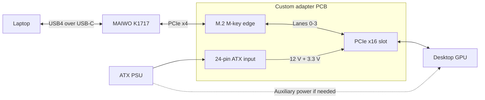

# eGPU Enclosure

Ever wanted to fire up Fortnite on your shoddy laptop? Well now you can!

Most of our laptops are GPU bottlenecked by integrated graphics that pair with a strong CPU. That's why big companies have started to make external desktop GPU enclosures. But they are expensive! That's why I'm designing my own.

I'm designing a PCB that lets a USB4 laptop connect to a desktop GPU. The MAIWO K1717 bridge tunnels PCIe over USB-C. My Altium board takes the bridge's M.2 PCIe link, routes it to a full-size GPU slot, and supplies slot power from an ATX power supply.

**Status:** Schematic complete. Began PCB layout design. Fabrication, and hardware testing are pending.

- **Data.** The slot accepts a physical x16 card and is wired for x4. Each lane has a transmit and a receive differential pair, so traffic can travel in both directions at once. Gen4 is a design target.
- **Control.** The board carries the differential reference clock (`REFCLK`) and clock request (`CLKREQ#`). The reset circuit combines the bridge's `PERST#` with the PSU's `PWR_OK` so the GPU is held in reset until both signals allow release.
- **Next.** Finish the M.2 edge footprint and check power sequencing before routing the controlled-impedance pairs. Hardware bring-up starts with power and PCIe link enumeration.

[Open the Altium project](altium/eGPU_Enclosure.PrjPcb) · [View the schematic preview](docs/schematic.png)

*The schematic and its symbol library are included. The referenced vendor footprints are external dependencies.*
